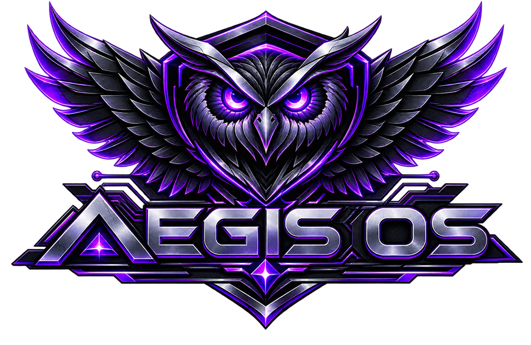
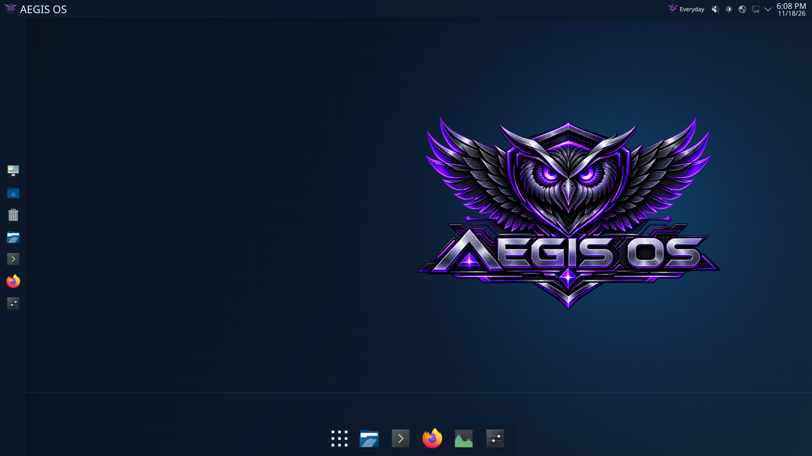
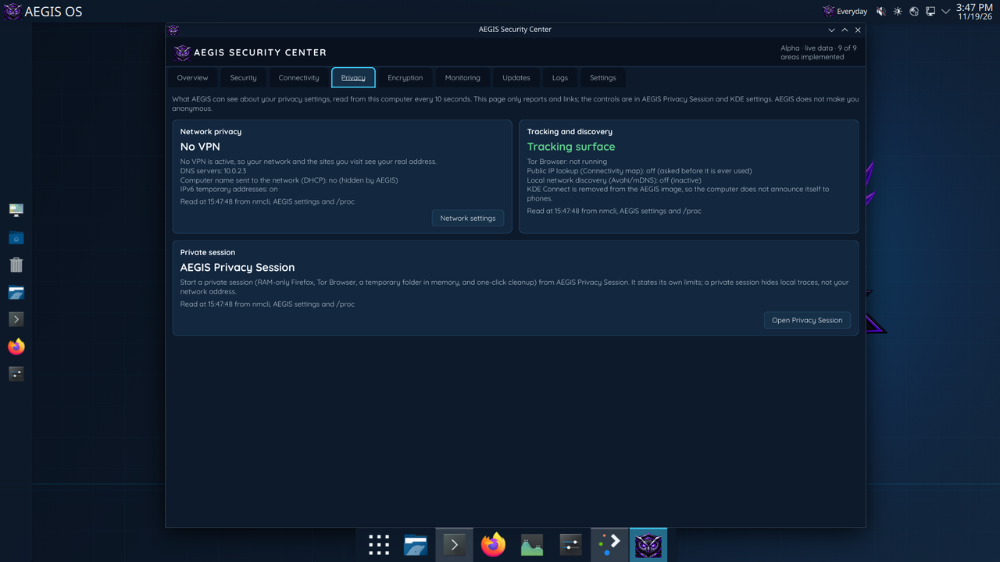
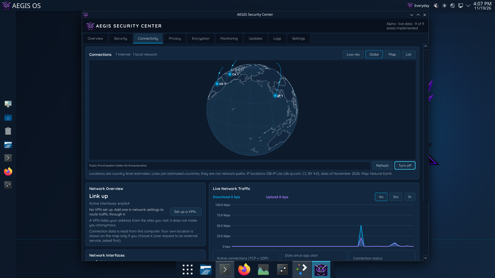
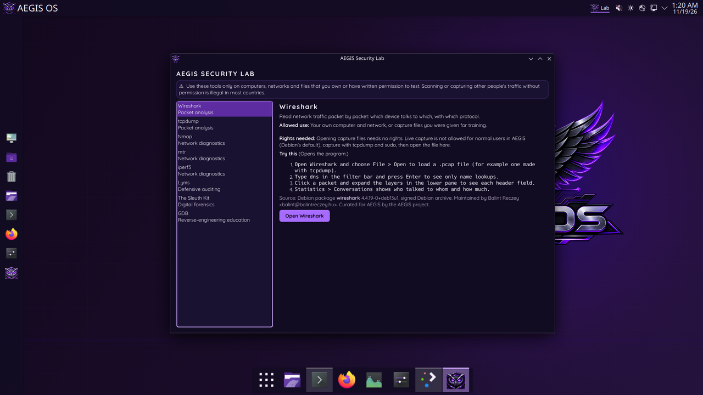
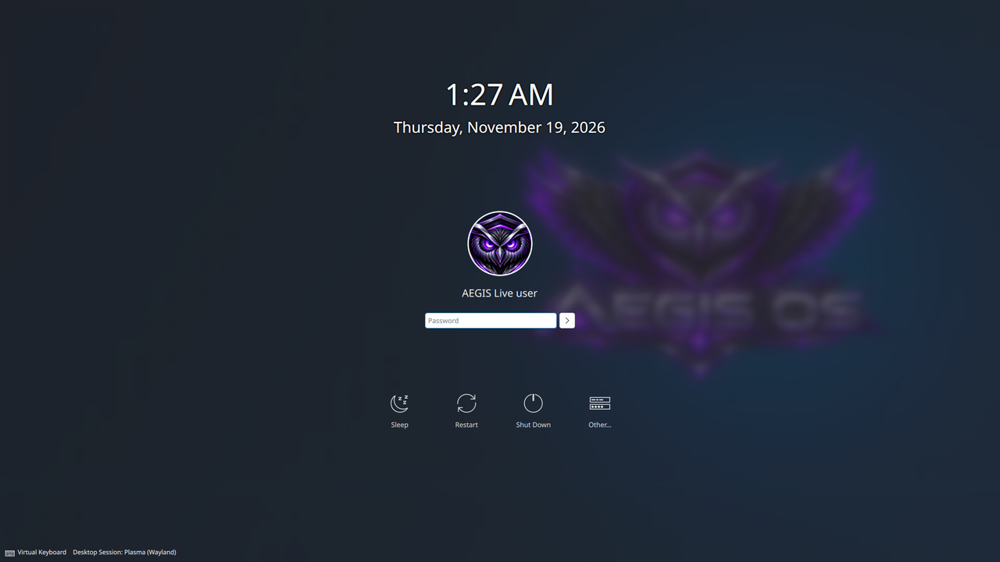

### Beyond the ordinary.

**A Debian-based Linux desktop for everyday work, privacy and cybersecurity learning.**

---

AEGIS OS is a Linux operating system in development. It combines a clean, fast everyday desktop with a separate, clearly marked **Lab** for learning defensive security, plus a built-in **Security Center** that shows what your computer is doing, read straight from the system and never sent anywhere.

## Highlights

| | |
|---|---|
| 🦉 **Two modes, one click** | Switch between **Everyday** (AEGIS Blue) and **Lab** (purple) from the top bar. Theme, wallpaper, terminal and tools follow. No password, no background service. |
| 🛡️ **AEGIS Security Center** | Nine areas in one place: Overview, Security, Connectivity, Privacy, Encryption, Monitoring, Updates, Logs and Settings. Every value is read from the system and marked fresh, stale or unavailable. |
| 🌍 **Live Connectivity globe** | An interactive 3D Earth showing where your connections go, with a 2D map, a list view and a low-resource mode. Country lookup runs offline; your own location is only looked up if you agree. |
| 🔐 **One-click VPN** | Turn your own configured VPN on or off from Connectivity, with an honest on / off / not-set-up state. |
| 🧪 **AEGIS Security Lab** | Curated, documented tools from Debian (Wireshark, tcpdump, Nmap, mtr, iperf3, Lynis, The Sleuth Kit, GDB). Each one shows its source, allowed use, required rights and guided first steps. |
| 🕶️ **Privacy Session** | A private Firefox that lives only in memory, Tor Browser through Debian's signed launcher, a temporary folder in RAM and one-click cleanup. |
| 🔔 **Security updates you can't miss** | Security fixes get a clear AEGIS card with *Update now* or *Later*. Checks pause on metered connections. |
| 🧱 **Hardened by default** | Firewall on, kernel hardening, computer name not broadcast to the network, local discovery off, KDE Connect removed, no telemetry. |
| 🧰 **Recovery and drivers** | One place for documented fixes, a privacy-safe support report and guided NVIDIA driver installation. |
| ♿ **Accessible** | High-contrast colour scheme, a reduced-motion boot option and keyboard-friendly apps. |

## Screenshots

> Real screenshots of AEGIS OS development builds running in a virtual machine, not mock-ups. The design may still change.

### Everyday and Lab

| Everyday Mode | Lab Mode |
|:---:|:---:|
|  |  |

### AEGIS Security Center

| Privacy | Monitoring |
|:---:|:---:|
|  |  |

### Connectivity

### AEGIS Security Lab

### From power-on to desktop

| Boot menu | Login |
|:---:|:---:|
|  |  |

## Principles

- **Honest by design.** AEGIS says what it protects against and what it does not. It never promises anonymity or perfect security.
- **Your data stays yours.** No hidden telemetry. Every network request the system makes is meant to be explained, and optional ones ask first.
- **Least privilege.** Apps run as you. Administrator rights are asked for one action at a time, never as a blanket root session.
- **Learn responsibly.** Lab tools are for systems you own or are allowed to test, and the Lab says so.

## Status

AEGIS OS is in **private development**. Development builds are tested in virtual machines and from a USB stick on real laptop hardware. There is no public release, download or source code yet.

 
