

 

<picture>
  <source media="(prefers-color-scheme: dark)" srcset="assets/logo-white.png">
  
</picture>

# AEGIS OS

### Beyond the ordinary.

**A Debian-based Linux desktop for everyday work, privacy and cybersecurity learning.**

---

AEGIS OS is a Linux operating system in development. One desktop, three modes: **Daily** for everyday work, **Gaming** for play and **Cyber** for learning defensive security, plus a built-in **Security Center** that shows what your computer is doing, read straight from the system and never sent anywhere.

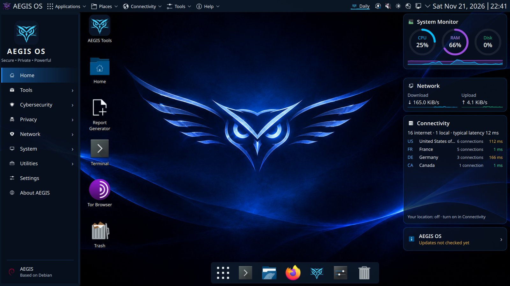

## 🎯 Our main goal

> **One operating system that is easy enough for everyday life and honest enough to trust with your security.**

Most people have to pick between a simple desktop that hides what it does and a security distribution that is hard to live with. AEGIS OS aims to remove that choice:

- **For everyone:** a modern, fast, smooth Linux desktop for work and browsing, safe from the first boot with nothing to configure.
- **For players:** a Gaming mode with its own look and performance settings, without switching off any protection.
- **For learners and defenders:** a built-in, clearly separated Cyber mode with the Security Lab for learning ethical, authorized cybersecurity, one click away.
- **For your privacy:** a system that shows what it is doing with real data, makes no hidden network requests and asks before optional ones.
- **For the long run:** a modular Debian base where every part updates on its own, so AEGIS can keep growing without breaking your computer.

## ✨ What's new

> New features below are built and tested in a virtual machine. They arrive on the installable image with the next build.

| | |
|---|---|
| 🦉 **New white Guardian Owl** | A clean, sharp owl emblem everywhere: boot screen, login, icons and wallpapers. At start-up the owl's eyes light up in AEGIS Blue. |
| 🎮 **Three modes: Daily, Gaming, Cyber** | A new **Gaming** mode with its own green look and the performance power profile on mains power. **Daily** keeps your own look and power settings. **Cyber** is the Security Lab. |
| 🎬 **Smooth mode transitions** | Every switch plays its own effect: Daily a soft fade, Gaming an energy burst, Cyber a scanline glitch. With reduced motion turned on it is a calm still image, and Esc skips it. |
| 🎛️ **Mode menu in the top bar** | Click the mode button and pick Daily, Gaming or Cyber, with a short description of each. Works with the keyboard too (arrows, Enter, Esc), and the active mode is shown by name and check mark, not by colour alone. |
| 🧷 **Safe switching** | A switch is checked after it is applied and only then counts. If something fails on the way into Gaming or Cyber, AEGIS puts your previous mode back instead of leaving a half-changed desktop. |
| 🕹️ **Gaming check and Quick Gaming** | A read-only check (`aegis-gaming status`) shows what your computer offers for games: graphics card and driver, Vulkan, GameMode, power profiles and installed launchers, with plain-language notes. Nothing is sent anywhere and nothing is installed. While Gaming mode is on, background file indexing pauses and resumes when you leave. |
| 🖼️ **Four new wallpapers** | AEGIS Blue, AEGIS Lab, AEGIS Monochrome and AEGIS Purple Scratch. |
| 🔥 **Stronger defaults, now tested** | Firewall on at boot, Firefox privacy settings active, fewer background look-ups at first start, and a security-update card that a stray Enter key cannot trigger. |
| 📦 **Built from modules** | Every AEGIS part is its own Debian package with its own version, so a fix can arrive as one small update instead of a whole new system image. |

## 🌗 Three modes, one owl

> **One click → Gaming. One click → Cyber lab. One click → back to Daily.**
>
> No reboot, no logout and no password. Firewall, AppArmor and security updates stay exactly the same in every mode.

<table>
<tr>
<td align="center" width="33%"> <b>Daily</b> · AEGIS Blue Work, browsing, everyday life</td>
<td align="center" width="33%"> <b>Gaming</b> · neon green Performance profile, quiet notifications while you play</td>
<td align="center" width="33%"> <b>Cyber</b> · Lab purple Authorized, defensive security learning</td>
</tr>
</table>

### Mode transitions

Each mode has its own transition, from simple to intense: a soft **Daily** fade, a **Gaming** energy burst and a **Cyber** glitch. The effect covers the screen while the desktop changes behind it, then reveals the new mode.

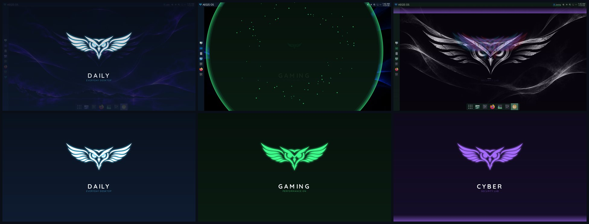

## 🔑 Highlights

| | |
|---|---|
| 🛡️ **AEGIS Security Center** | Nine areas in one place. Every value is read from the system, never guessed and never sent anywhere. |
| 🌍 **Live Connectivity globe and map** | See where your connections go. Country lookup runs offline; your own location is only looked up if you agree. |
| 🔐 **One-click VPN** | Turn your own configured VPN on or off from Connectivity. |
| 🎮 **Gaming mode** | Performance power profile on mains power, notifications paused while a game runs, file indexing paused, a Gaming check for your hardware, and your normal settings back when you leave. |
| 🧪 **AEGIS Security Lab** | Curated, documented tools from Debian (Wireshark, tcpdump, Nmap, mtr, iperf3, Lynis, The Sleuth Kit, GDB). Each one shows its source, allowed use, required rights and guided first steps. |
| 🕶️ **Privacy Session** | A private Firefox that lives only in memory, Tor Browser through Debian's signed launcher, a temporary folder in RAM and one-click cleanup. |
| 🔔 **Security updates you can't miss** | Security fixes get a clear AEGIS card with *Update now* or *Later*. Checks pause on metered connections. |
| 🧱 **Hardened by default** | Firewall on, AppArmor, kernel hardening, computer name not broadcast, local discovery off, KDE Connect removed, no telemetry. |
| 🧰 **Recovery and drivers** | Documented fixes, a privacy-safe support report and guided NVIDIA driver installation. |
| ♿ **Accessible** | High-contrast colour scheme, reduced motion for the boot screen and mode transitions, contrast-checked colours in every mode, and keyboard-friendly apps. |

## 🖼️ Screenshots

> Real screenshots of AEGIS OS development builds running in a virtual machine, not mock-ups.

### Daily, Gaming and Cyber

| Daily | Gaming | Cyber |
|:---:|:---:|:---:|
|  | 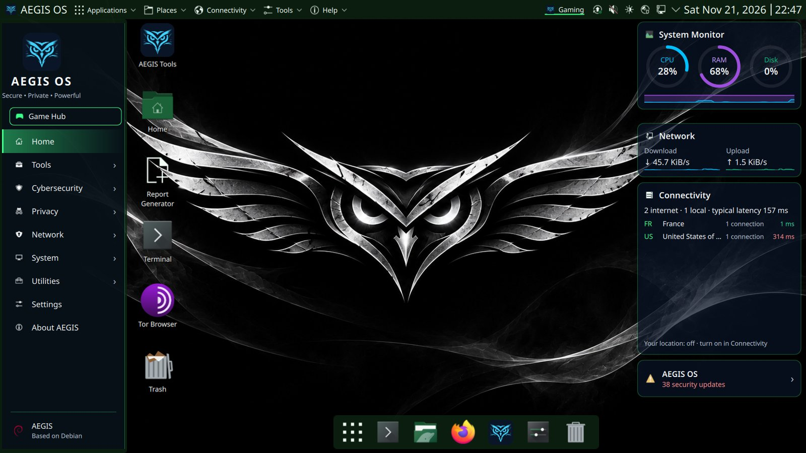 | 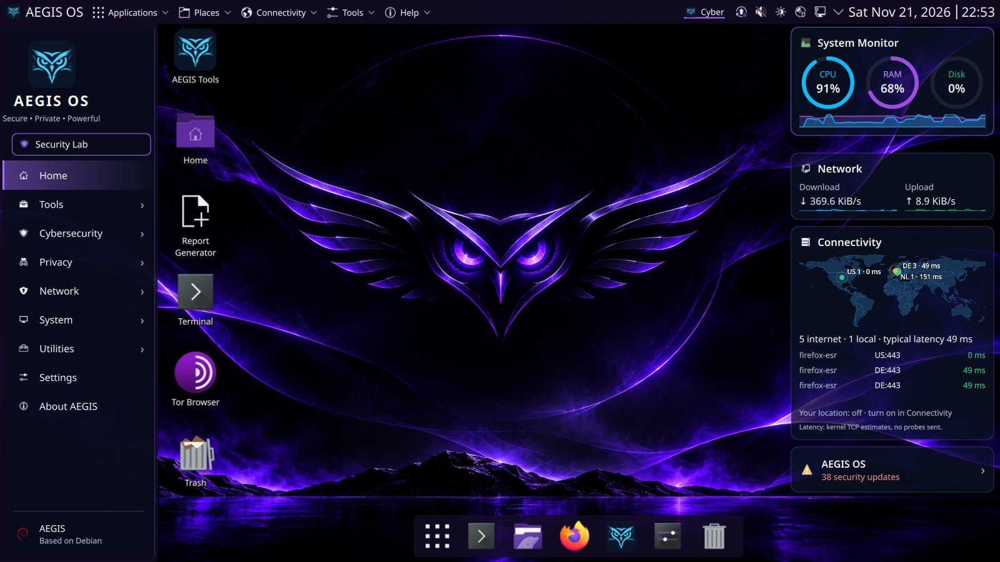 |

Pick a mode from the top bar:

AEGIS apps follow the mode, here Security Center in Gaming mode:

### AEGIS Security Center

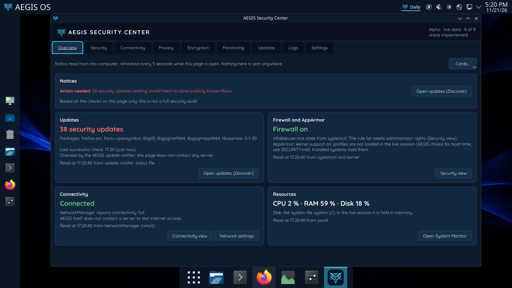

| Privacy | Monitoring |
|:---:|:---:|
|  | 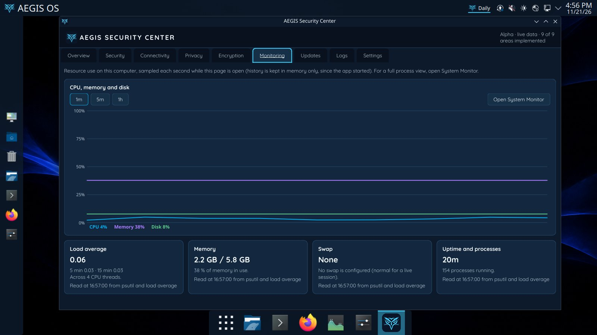 |

Security fixes get their own card, with *Update now* or *Later*:

### Connectivity

Connections shown by country on a map or a globe, worked out offline on your computer:

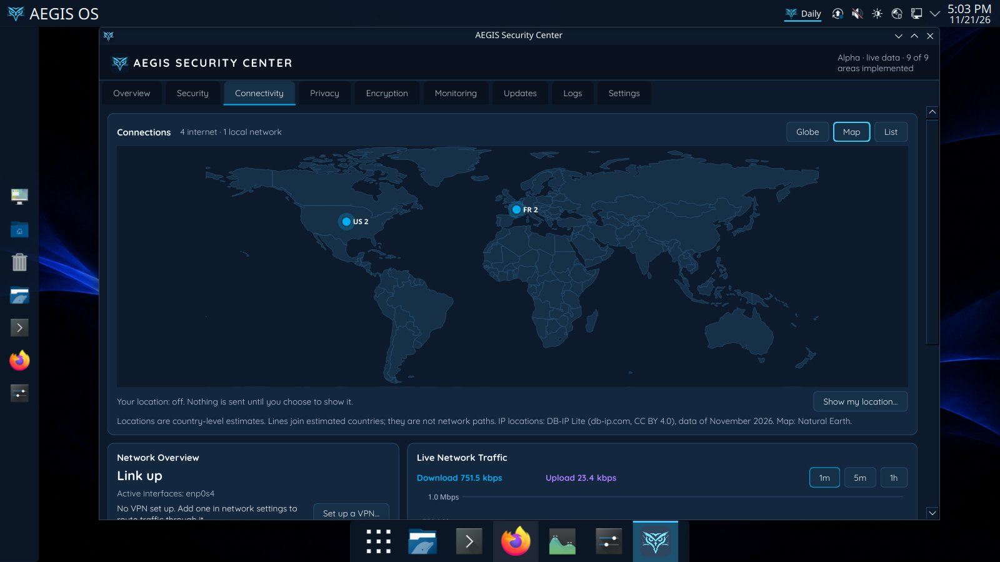

### AEGIS Security Lab

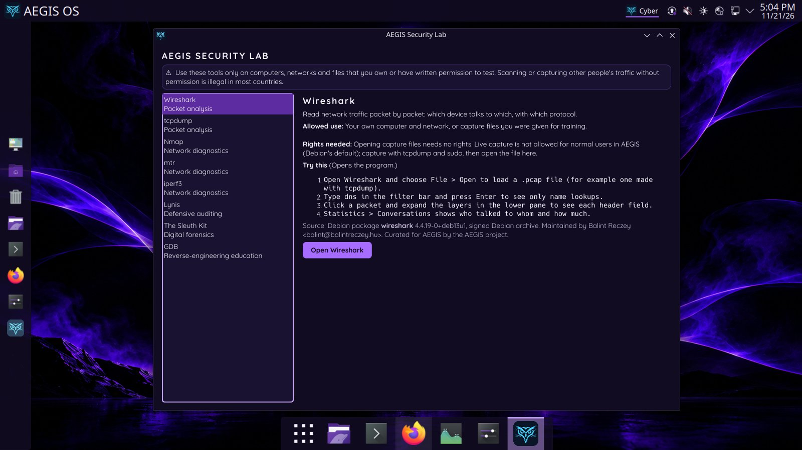

### From power-on to desktop

| Boot screen | Login |
|:---:|:---:|
|  | 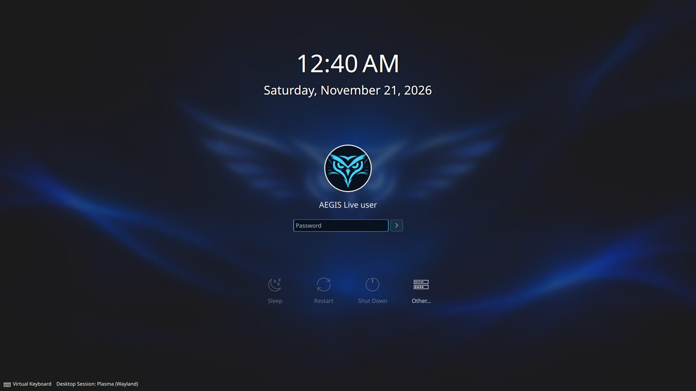 |

| Boot menu |
|:---:|
| 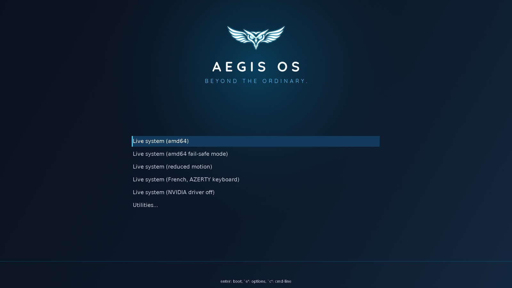 |

## 🔭 Future vision

> **Where AEGIS is heading:** from today's private preview to a **1.0 release** that anyone can install, keep updated and trust, and then on to a **security workstation with an ethical AI assistant**. Every step ships only after it passes its tests.

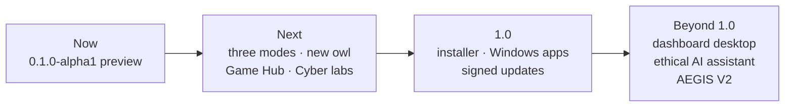

**Next**

- **Next build:** the white owl, three modes with the mode menu, transitions, safe switching and the Gaming check on the installable image.
- **Gaming:** hardware-aware performance settings and an optional full-screen Game Hub. Game launchers stay your choice and are never installed without asking.
- **Cyber Virtual Labs:** optional practice machines, offline and isolated by default, with beginner templates and advanced management.
- **Updates done properly:** module-aware updates with history, health checks, and rollback if something goes wrong.

**On the way to 1.0**

- **Installer:** a beginner flow with safe defaults and a clear summary, and an advanced flow with manual partitioning and full-disk encryption.
- **AEGIS EXE Bridge:** guided support for Windows apps through Wine. Compatibility will be documented honestly, not promised, and Wine is not a sandbox.
- **Signed AEGIS updates:** stable and testing channels with signed packages.
- **1.0 release:** a clean, reproducible build with checksums, a supported-hardware list and known issues.

**Beyond 1.0**

- **Dashboard desktop:** System Monitor, Network and Connectivity cards on the desktop, with a terminal docked at the bottom that holds multiple tabs.
- **AEGIS AI Assistant:** a guided assistant for *authorized* security work that explains triage, recon and pentest workflows step by step. It refuses targets outside what you are allowed to test, asks before every impactful action and keeps a log. No autonomous attacks, mass scanning, credential theft or stealth features, ever.
- **AEGIS V2:** an amnesic live mode, stronger isolation, advanced monitoring, better privacy and wider hardware support.

Plans may change. Nothing here is promised until it is built and tested.

## 🧭 Principles

- **Honest by design.** AEGIS says what it protects against and what it does not. It never promises anonymity or perfect security.
- **Your data stays yours.** No hidden telemetry. Every network request the system makes is meant to be explained, and optional ones ask first.
- **Least privilege.** Apps run as you. Administrator rights are asked for one action at a time, never as a blanket root session.
- **Learn responsibly.** Lab tools are for systems you own or are allowed to test, and the Lab says so.

## 📍 Status

AEGIS OS is in **private development**. Development builds are tested in virtual machines and from a USB stick on real laptop hardware. There is no public release, download or source code yet.

 

 
AEGIS OS is built on Debian, KDE Plasma and many other free software projects, which keep their own licences.

