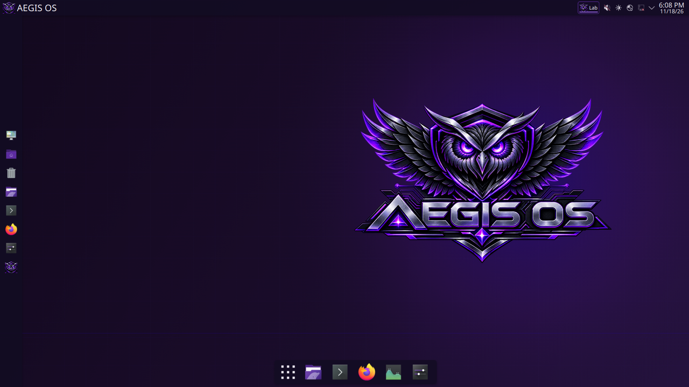
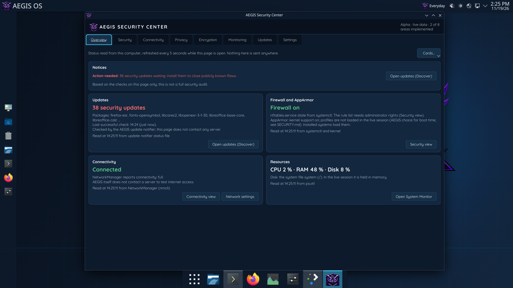
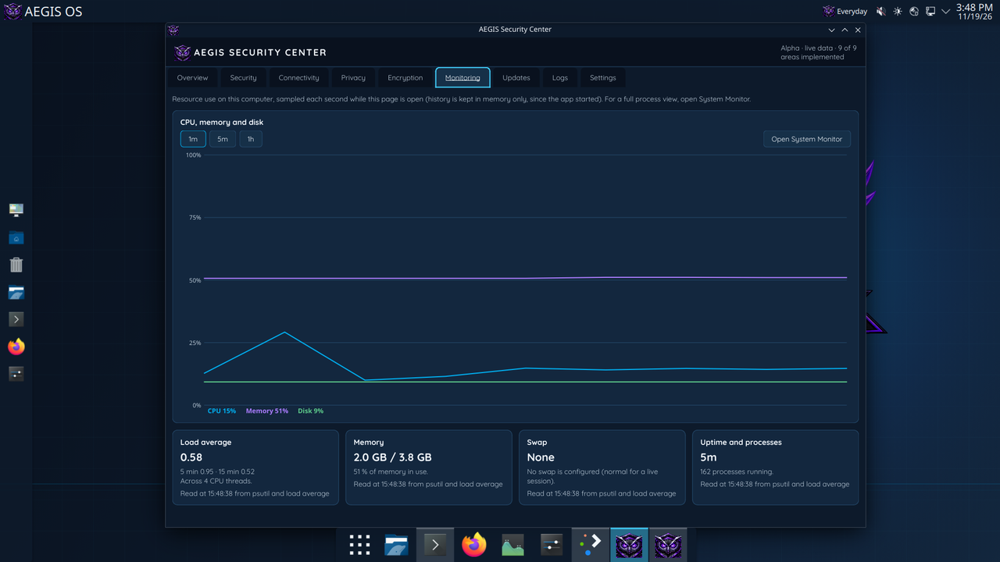
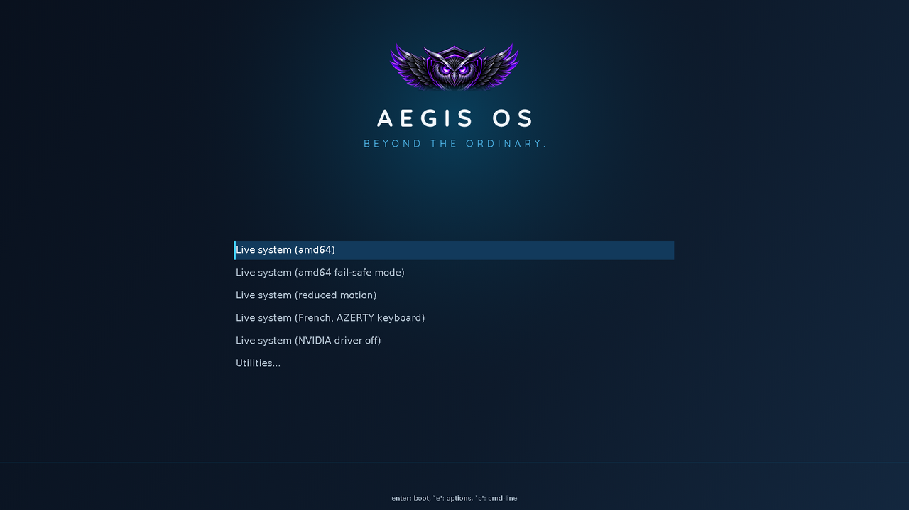
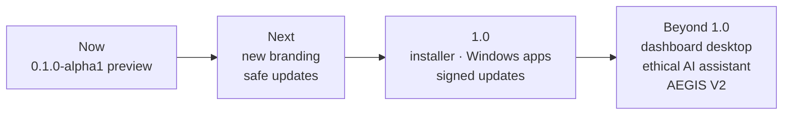

 

<picture>
  <source media="(prefers-color-scheme: dark)" srcset="assets/logo-white.png">
  
</picture>

# AEGIS OS

### Secure • Private • Independent

**A Debian-based Linux desktop for everyday work, privacy and cybersecurity learning.**

---

AEGIS OS is a Linux operating system in development. It combines a clean, fast everyday desktop with a separate, clearly marked **Lab** for learning defensive security, plus a built-in **Security Center** that shows what your computer is doing, read straight from the system and never sent anywhere.

## 🎯 Our main goal

> **One operating system that is easy enough for everyday life and honest enough to trust with your security.**

Most people have to pick between a simple desktop that hides what it does and a security distribution that is hard to live with. AEGIS OS aims to remove that choice:

- **For everyone:** a modern, fast, smooth Linux desktop for work, browsing and gaming, safe from the first boot with nothing to configure.
- **For learners and defenders:** a built-in, clearly separated Security Lab for learning ethical, authorized cybersecurity, one click away.
- **For your privacy:** a system that shows what it is doing with real data, makes no hidden network requests and asks before optional ones.
- **For the long run:** a modular Debian base where every part updates on its own, so AEGIS can keep growing without breaking your computer.

## ✨ What's new

| | |
|---|---|
| 🦉 **New Guardian Owl identity** | A new winged owl emblem: **AEGIS Blue** for Everyday, **Lab purple** for the Security Lab. It already appears here; the desktop, boot menu and boot splash follow in an upcoming build. |
| 📦 **Built from modules** | Every AEGIS part (apps, branding, desktop defaults, security settings) is now its own Debian package with its own version. A fix can arrive as one small update instead of a whole new system image. |
| 🛡️ **Security Center: all nine areas** | Overview, Security, Connectivity, Privacy, Encryption, Monitoring, Updates, Logs and Settings, each value marked fresh, stale or unavailable. |
| 🌍 **3D Connectivity globe + one-click VPN** | Live connection arcs on an interactive Earth, 2D map and list views, a low-resource mode, offline country lookup, and a VPN button with an honest on / off / not-set-up state. |
| 🔥 **Stronger defaults (in testing)** | Firewall switched on at boot, Firefox pre-fetching and background look-ups turned off, and a safer security-update card. These fixes are in the build currently being tested. |
| 🏷️ **First versioned preview** | *AEGIS OS 0.1.0-alpha1 preview*: the first build with a proper version number. |

## 🌗 Two modes, one owl

> **One click → hacking lab. One click → back to everyday and gaming.**
>
> Click **Lab** in the top bar and AEGIS turns into a security workstation: purple theme, Lab terminal and the Security Lab toolkit, ready for ethical hacking on systems you own or are authorized to test.
> Click **Everyday** and it is a clean, simple desktop again, with the Lab tools tucked away, ready for daily work, browsing and gaming.
> No reboot, no logout, no password, and nothing running in the background.

<table>
<tr>
<td align="center" width="50%"> <b>Everyday</b> · AEGIS Blue Daily work, browsing and gaming</td>
<td align="center" width="50%"> <b>Security Lab</b> · Lab purple Authorized, defensive security learning</td>
</tr>
</table>

## 🔑 Highlights

| | |
|---|---|
| 🛡️ **AEGIS Security Center** | Nine areas in one place. Every value is read from the system, never guessed and never sent anywhere. |
| 🌍 **Live Connectivity globe** | See where your connections go. Country lookup runs offline; your own location is only looked up if you agree. |
| 🔐 **One-click VPN** | Turn your own configured VPN on or off from Connectivity. |
| 🧪 **AEGIS Security Lab** | Curated, documented tools from Debian (Wireshark, tcpdump, Nmap, mtr, iperf3, Lynis, The Sleuth Kit, GDB). Each one shows its source, allowed use, required rights and guided first steps. |
| 🕶️ **Privacy Session** | A private Firefox that lives only in memory, Tor Browser through Debian's signed launcher, a temporary folder in RAM and one-click cleanup. |
| 🔔 **Security updates you can't miss** | Security fixes get a clear AEGIS card with *Update now* or *Later*. Checks pause on metered connections. |
| 🧱 **Hardened by default** | Firewall on, AppArmor, kernel hardening, computer name not broadcast, local discovery off, KDE Connect removed, no telemetry. |
| 🧰 **Recovery and drivers** | Documented fixes, a privacy-safe support report and guided NVIDIA driver installation. |
| ♿ **Accessible** | High-contrast colour scheme, a reduced-motion boot option and keyboard-friendly apps. |

## 🖼️ Screenshots

> Real screenshots of AEGIS OS development builds running in a virtual machine, not mock-ups. They still show the **previous** owl emblem; the new identity arrives in an upcoming build.

### Everyday and Lab

| Everyday Mode | Lab Mode |
|:---:|:---:|
|  |  |

### AEGIS Security Center

| Privacy | Monitoring |
|:---:|:---:|
|  |  |

### Connectivity

### AEGIS Security Lab

### From power-on to desktop

| Boot menu | Login |
|:---:|:---:|
|  |  |

## 🔭 Future vision

> **Where AEGIS is heading:** from today's private preview to a **1.0 release** that anyone can install, keep updated and trust, and then on to a **security workstation with an ethical AI assistant**. Every step ships only after it passes its tests.

**Next**

- **New Guardian Owl everywhere:** icons, wallpapers, login, boot menu and boot splash in AEGIS Blue and Lab purple.
- **Updates done properly:** module-aware updates with history, health checks, and rollback if something goes wrong.

**On the way to 1.0**

- **Installer:** a beginner flow with safe defaults and a clear summary, and an advanced flow with manual partitioning and full-disk encryption.
- **AEGIS EXE Bridge:** guided support for Windows apps through Wine. Compatibility will be documented honestly, not promised, and Wine is not a sandbox.
- **Signed AEGIS updates:** stable and testing channels with signed packages.
- **1.0 release:** a clean, reproducible build with checksums, a supported-hardware list and known issues.

**Beyond 1.0**

- **Dashboard desktop:** System Monitor, Network and Connectivity cards on the desktop, with a terminal docked at the bottom that holds multiple tabs.
- **AEGIS AI Assistant:** a guided assistant for *authorized* security work that explains triage, recon and pentest workflows step by step. It refuses targets outside what you are allowed to test, asks before every impactful action and keeps a log. No autonomous attacks, mass scanning, credential theft or stealth features, ever.
- **AEGIS V2:** an amnesic live mode, stronger isolation, advanced monitoring, better privacy and wider hardware support.

Plans may change. Nothing here is promised until it is built and tested.

## 🧭 Principles

- **Honest by design.** AEGIS says what it protects against and what it does not. It never promises anonymity or perfect security.
- **Your data stays yours.** No hidden telemetry. Every network request the system makes is meant to be explained, and optional ones ask first.
- **Least privilege.** Apps run as you. Administrator rights are asked for one action at a time, never as a blanket root session.
- **Learn responsibly.** Lab tools are for systems you own or are allowed to test, and the Lab says so.

## 📍 Status

AEGIS OS is in **private development**. Development builds are tested in virtual machines and from a USB stick on real laptop hardware. There is no public release, download or source code yet.

 

 
AEGIS OS is built on Debian, KDE Plasma and many other free software projects, which keep their own licences.

