

 

<picture>
  <source media="(prefers-color-scheme: dark)" srcset="assets/logo-white.png">
  
</picture>

# AEGIS OS

### Beyond the ordinary.

**A Debian-based Linux desktop for everyday work, privacy and cybersecurity learning.**

---

AEGIS OS is a Linux operating system in development. One desktop, three modes: **Daily** for everyday work, **Gaming** for play and **Cyber** for learning defensive security. The new AEGIS desktop puts a category sidebar on the left and live cards for your system, network and connections on the right, and the built-in **Security Center** shows what your computer is doing, read straight from the system and never sent anywhere.

## 🎯 Our main goal

> **One operating system that is easy enough for everyday life and honest enough to trust with your security.**

Most people have to pick between a simple desktop that hides what it does and a security distribution that is hard to live with. AEGIS OS aims to remove that choice:

- **For everyone:** a modern, fast, smooth Linux desktop for work and browsing, safe from the first boot with nothing to configure.
- **For players:** a Gaming mode with its own look and performance settings, without switching off any protection.
- **For learners and defenders:** a built-in, clearly separated Cyber mode with the Security Lab for learning ethical, authorized cybersecurity, one click away.
- **For your privacy:** a system that shows what it is doing with real data, makes no hidden network requests and asks before optional ones.
- **For the long run:** a modular Debian base where every part updates on its own, so AEGIS can keep growing without breaking your computer.

## ✨ What's new

> New features below are built and tested in a virtual machine (see [How it is tested](#-how-it-is-tested)). They are now on the installable test image, which passed its full virtual-machine test; the real-laptop test is next.

| | |
|---|---|
| 🖥️ **New AEGIS desktop** | A top bar with Applications, Places, Connectivity, Tools and Help menus; a left sidebar with every AEGIS area sorted into categories; and a column of glass cards on the right. Designed for laptop and desktop screens: checked at 1920×1080, 1600×900 and 1366×768. |
| 📊 **Live cards on the desktop** | **System Monitor** (CPU, memory, disk), **Network** (download and upload) and **AEGIS OS** status (*System is up to date* or what needs attention). One shared, low-frequency update keeps them light, and they pause while hidden. |
| 🌍 **Connectivity card** | Daily and Gaming show a short summary: how many connections, which countries, typical latency. **Cyber** shows a live world map with the countries you are connected to, latency per country and the fastest connections. Latency is the kernel's own measurement of your existing connections: AEGIS sends no probe packets, and your public IP appears only if you agree. |
| 🕹️ **AEGIS Game Hub** | An optional full-screen place for game launchers (Steam, Lutris, RetroArch, Heroic) with the Gaming check built in. Launchers are installed only when you ask, run as you, and AEGIS never reads your game libraries. Esc leaves the Hub. |
| ♿ **Easier to read** | Small text on the desktop cards meets the 4.5:1 contrast guideline on the Daily, Gaming and Cyber wallpapers, every card can be reached with Tab and opened with Enter, and long labels shorten neatly instead of running off the edge. |
| 🦉 **New white Guardian Owl** | A clean, sharp owl emblem everywhere: boot screen, login, icons and wallpapers. At start-up the owl's eyes light up in AEGIS Blue. |
| 🎮 **Three modes: Daily, Gaming, Cyber** | A new **Gaming** mode with its own green look and the performance power profile on mains power. **Daily** keeps your own look and power settings. **Cyber** is the Security Lab. |
| 🎬 **Smooth mode transitions** | Every switch plays its own effect: Daily a soft fade, Gaming an energy burst, Cyber a scanline glitch. With reduced motion turned on it is a calm still image, and Esc skips it. |
| 🎛️ **Mode menu in the top bar** | Click the mode button and pick Daily, Gaming or Cyber, with a short description of each. Works with the keyboard too (arrows, Enter, Esc), and the active mode is shown by name and check mark, not by colour alone. |
| 🧷 **Safe switching** | A switch is checked after it is applied and only then counts. If something fails on the way into Gaming or Cyber, AEGIS puts your previous mode back instead of leaving a half-changed desktop. |
| 🕹️ **Gaming check and Quick Gaming** | A read-only check (`aegis-gaming status`) shows what your computer offers for games: graphics card and driver, Vulkan, GameMode, power profiles and installed launchers, with plain-language notes. Nothing is sent anywhere and nothing is installed. While Gaming mode is on, background file indexing pauses and resumes when you leave. |
| 🖼️ **Four new wallpapers** | AEGIS Blue, AEGIS Lab, AEGIS Monochrome and AEGIS Purple Scratch. |
| 🔥 **Stronger defaults, now tested** | Firewall on at boot, Firefox privacy settings active, fewer background look-ups at first start, and a security-update card that a stray Enter key cannot trigger. |
| 📦 **Built from modules** | Every AEGIS part is its own Debian package with its own version, so a fix can arrive as one small update instead of a whole new system image. |

## 🌗 Three modes, one owl

> **One click → Gaming. One click → Cyber lab. One click → back to Daily.**
>
> No reboot, no logout and no password. Firewall, AppArmor and security updates stay exactly the same in every mode.

<table>
<tr>
<td align="center" width="33%"> <b>Daily</b> · AEGIS Blue Work, browsing, everyday life</td>
<td align="center" width="33%"> <b>Gaming</b> · neon green Performance profile, quiet notifications while you play</td>
<td align="center" width="33%"> <b>Cyber</b> · Lab purple Authorized, defensive security learning</td>
</tr>
</table>

### Mode transitions

Each mode has its own transition, from simple to intense: a soft **Daily** fade, a **Gaming** energy burst and a **Cyber** glitch. The effect covers the screen while the desktop changes behind it, then reveals the new mode.

## 🔑 Highlights

| | |
|---|---|
| 🛡️ **AEGIS Security Center** | Nine areas in one place. Every value is read from the system, never guessed and never sent anywhere. |
| 🌍 **Live Connectivity globe and map** | See where your connections go. Country lookup runs offline; your own location is only looked up if you agree. |
| 🔐 **One-click VPN** | Turn your own configured VPN on or off from Connectivity. |
| 🖥️ **AEGIS desktop** | Category sidebar, top-bar menus and live cards for system, network, connections and updates, in the colour of the current mode. |
| 🎮 **Gaming mode** | Performance power profile on mains power, notifications paused while a game runs, file indexing paused, a Gaming check for your hardware, and your normal settings back when you leave. The optional **Game Hub** keeps your launchers in one full-screen place. |
| 🧪 **AEGIS Security Lab** | Curated, documented tools from Debian (Wireshark, tcpdump, Nmap, mtr, iperf3, Lynis, The Sleuth Kit, GDB). Each one shows its source, allowed use, required rights and guided first steps. |
| 🕶️ **Privacy Session** | A private Firefox that lives only in memory, Tor Browser through Debian's signed launcher, a temporary folder in RAM and one-click cleanup. |
| 🔔 **Security updates you can't miss** | Security fixes get a clear AEGIS card with *Update now* or *Later*. Checks pause on metered connections. |
| 🧱 **Hardened by default** | Firewall on, AppArmor, kernel hardening, computer name not broadcast, local discovery off, KDE Connect removed, no telemetry. |
| 🧰 **Recovery and drivers** | Documented fixes, a privacy-safe support report and guided NVIDIA driver installation. |
| ♿ **Accessible** | High-contrast colour scheme, reduced motion for the boot screen and mode transitions, contrast-checked colours in every mode, and keyboard-friendly apps. |

## 🖼️ Screenshots

> Real screenshots of AEGIS OS development builds running in a virtual machine, not mock-ups.

### Daily, Gaming and Cyber

| Daily | Gaming | Cyber |
|:---:|:---:|:---:|
|  |  |  |

### The AEGIS desktop

Every AEGIS area sorted into categories in the sidebar, and quick menus in the top bar:

| Sidebar categories | Top-bar menus |
|:---:|:---:|
| 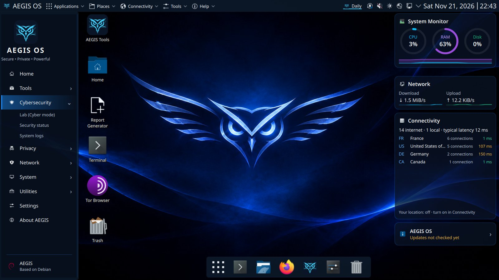 | 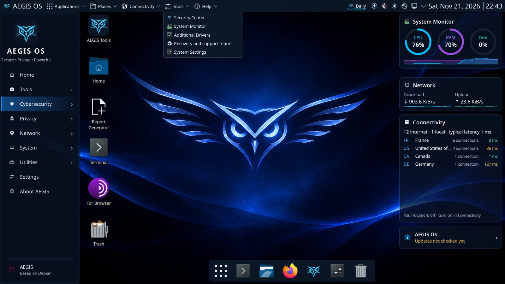 |

<table>
<tr>
<td width="30%">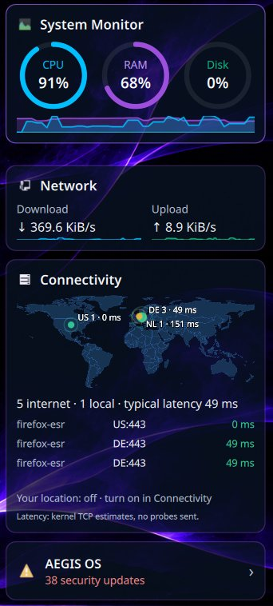</td>
<td>

**The cards in Cyber mode**

- **System Monitor:** CPU, memory and disk with a short history.
- **Network:** live download and upload.
- **Connectivity:** a live map of the countries you are connected to, latency per country and the fastest connections. Latency comes from the kernel's own measurements of connections that already exist; nothing extra is sent.
- **AEGIS OS:** update and firewall status. Click or press Enter to open the matching Security Center page.

</td>
</tr>
</table>

Smaller laptop screens get a tighter layout instead of cut-off cards (1366×768):

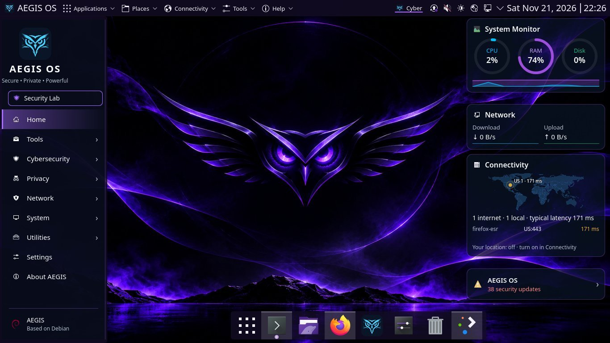

Pick a mode from the top bar:

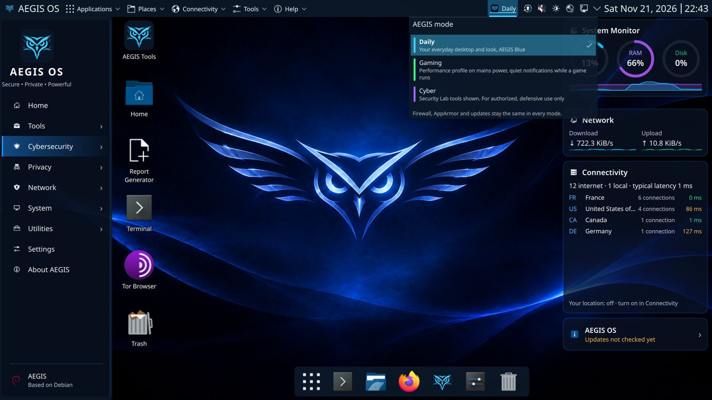

### AEGIS Game Hub

Your launchers in one full-screen place, with an honest Gaming check of your hardware (here a virtual machine, so it says games will be slow):

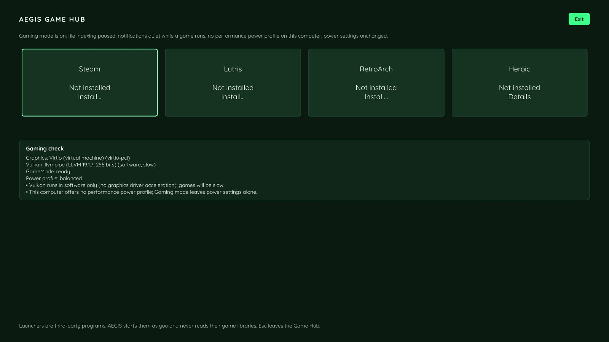

AEGIS apps follow the mode, here Security Center in Gaming mode:

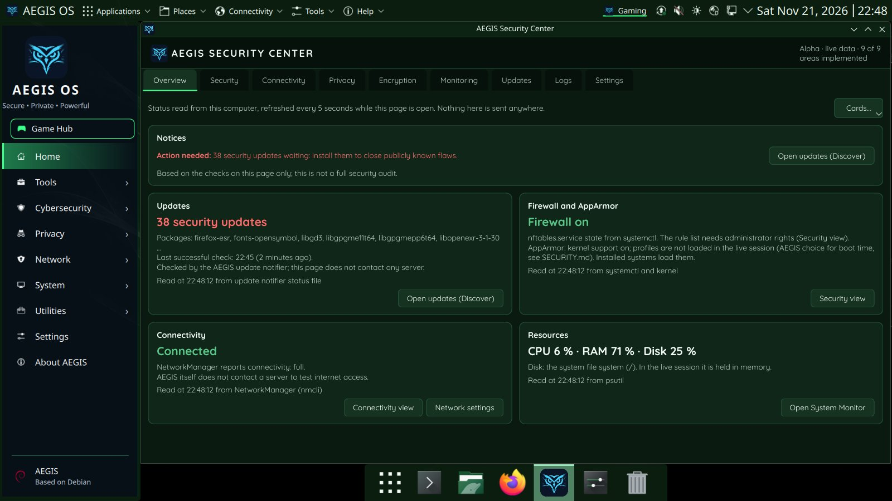

### AEGIS Security Center

| Privacy | Monitoring |
|:---:|:---:|
| 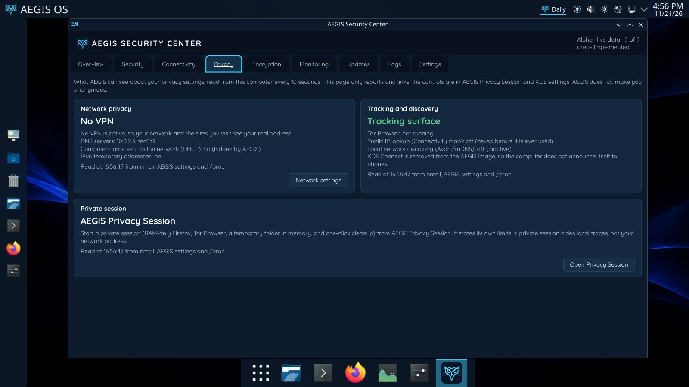 |  |

Security fixes get their own card, with *Update now* or *Later*:

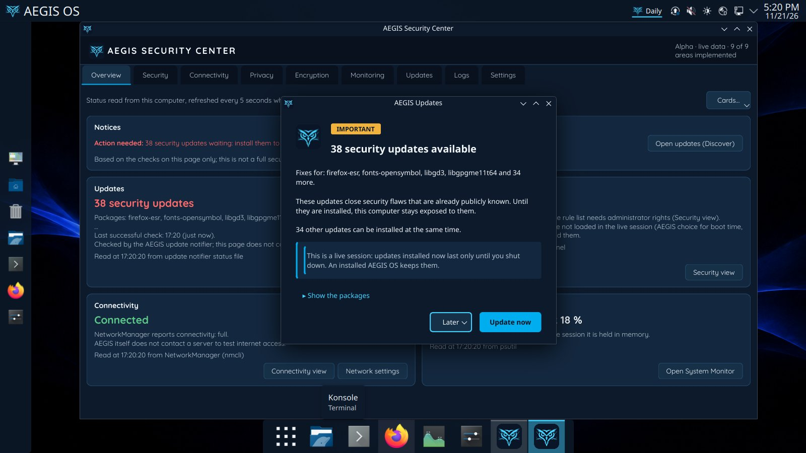

### Connectivity

Connections shown by country on a map or a globe, worked out offline on your computer:

### AEGIS Security Lab

### From power-on to desktop

| Boot screen | Login |
|:---:|:---:|
| 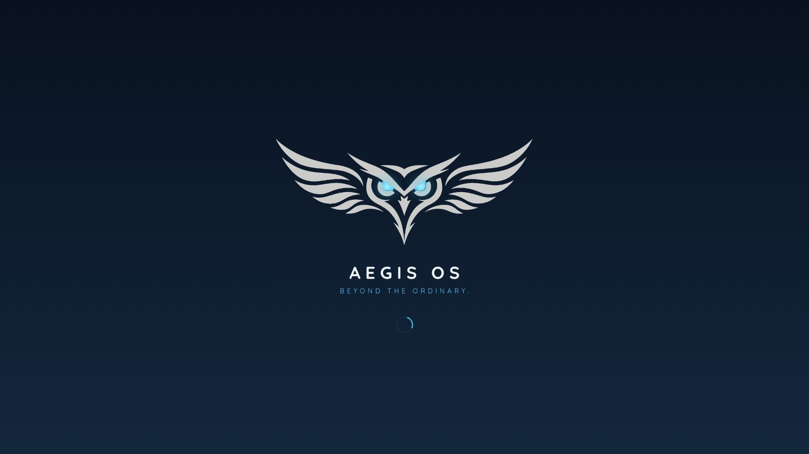 |  |

| Boot menu |
|:---:|
|  |

## 🧪 How it is tested

> Every feature on this page has been run, not just designed. Here is what the current development build has been checked with.

| Check | Result |
|---|---|
| 📦 Package tests in fresh Debian 13 systems: install, update, refusing incompatible versions, removal | **173 passed, 0 failed** |
| 🌗 Mode engine tests (Daily, Gaming, Cyber, transitions, safe switching, rollback) | **213 passed** |
| 🖥️ Desktop card tests (data, layout, contrast) | **18 passed** |
| 🧭 Desktop layout in a virtual machine | Checked at **1920×1080 and 1366×768** (Daily and Cyber) and **1600×900** (Daily, Gaming and Cyber): nothing cut off, nothing overlapping |
| ♿ Contrast of small text on the desktop cards | **At least 4.5:1**, measured on the brightest part of the Cyber wallpaper |
| ⌨️ Keyboard | Tab reaches every card with a visible focus border; Enter opens the matching Security Center page |
| 🔕 Network honesty | The Connectivity card sends no probe packets; your public IP is looked up only after you agree |
| 🧪 Full test of the installable image in a virtual machine | **3 boots** (1920×1080 online, 1366×768 offline, reduced motion): **every automatic check passed, 0 failed**. The desktop cards, which Plasma can squeeze on the very first login, are put back in place automatically and stay there |
| 💻 Real hardware | Earlier builds (security foundation, Daily/Lab modes, Privacy Session) passed a USB test on a real laptop. The new build gets the same test next |

Not tested yet for the new desktop: screen readers, 4K/HiDPI scaling and real hardware.

## 🔭 Future vision

> **Where AEGIS is heading:** from today's private preview to a **1.0 release** that anyone can install, keep updated and trust, and then on to a **security workstation with an ethical AI assistant**. Every step ships only after it passes its tests.

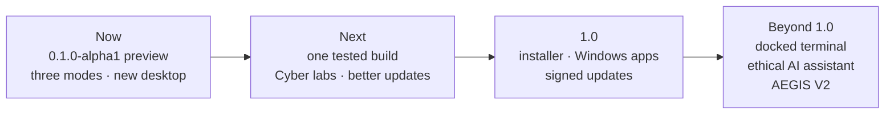

**Next**

- **Real-hardware test:** the new build (AEGIS desktop and cards, white owl, three modes, Game Hub) passed its full virtual-machine test; next it runs on a real laptop from a USB stick, before anything else moves on.
- **Cyber Virtual Labs:** optional practice machines, offline and isolated by default, with beginner templates and advanced management.
- **Updates done properly:** module-aware updates with history, health checks, and rollback if something goes wrong.

**On the way to 1.0**

- **Installer:** a beginner flow with safe defaults and a clear summary, and an advanced flow with manual partitioning and full-disk encryption.
- **AEGIS EXE Bridge:** guided support for Windows apps through Wine. Compatibility will be documented honestly, not promised, and Wine is not a sandbox.
- **Signed AEGIS updates:** stable and testing channels with signed packages.
- **1.0 release:** a clean, reproducible build with checksums, a supported-hardware list and known issues.

**Beyond 1.0**

- **Docked terminal:** a terminal docked at the bottom of the desktop that holds multiple tabs. (The dashboard cards are already done, see above.)
- **AEGIS AI Assistant:** a guided assistant for *authorized* security work that explains triage, recon and pentest workflows step by step. It refuses targets outside what you are allowed to test, asks before every impactful action and keeps a log. No autonomous attacks, mass scanning, credential theft or stealth features, ever.
- **AEGIS V2:** an amnesic live mode, stronger isolation, advanced monitoring, better privacy and wider hardware support.

### 🚀 The long road: from an OS to the AEGIS Company

> AEGIS starts as an operating system, but the vision is bigger: a whole family of products built around the same idea of **security you can see and trust**, all the way to the final goal: **AEGIS Company by "KRDN."**

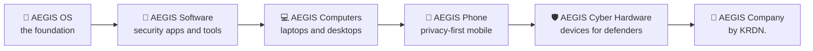

| Stage | The idea |
|---|---|
| 🦉 **AEGIS OS** | Today's work: a secure, beautiful, honest desktop for everyday users, gamers and ethical hackers. Everything else grows from it. |
| 🧩 **AEGIS Software** | The AEGIS apps (Security Center, Network Observatory, Game Hub, the Lab and the future AI assistant) grown into a full software suite, with tools that can also help people on other systems. |
| 💻 **AEGIS Computers** | Laptops and desktops that ship with AEGIS OS ready to go, with parts chosen to work well with it and to respect privacy and repairability. |
| 📱 **AEGIS Phone** | The AEGIS idea in your pocket: a privacy-first phone experience with the same honest security, clear permissions and the owl look. |
| 🛡️ **AEGIS Cyber Hardware** | Hardware for defenders and learners, such as network protection devices, security keys and kits for *authorized* security training and testing. |
| 🎓 **And more** | Learning and certification paths for new cyber defenders, services for teams, and a community around ethical security. |
| 🏢 **AEGIS Company by "KRDN."** | The last goal: one company that brings it all together, from software to hardware, built on the same principles as the OS. |

This is a long-term vision, not a product list. None of these products exist yet apart from AEGIS OS, which is in private development. Each step will only start once the one before it is solid.

Plans may change. Nothing here is promised until it is built and tested.

## 🧭 Principles

- **Honest by design.** AEGIS says what it protects against and what it does not. It never promises anonymity or perfect security.
- **Your data stays yours.** No hidden telemetry. Every network request the system makes is meant to be explained, and optional ones ask first.
- **Least privilege.** Apps run as you. Administrator rights are asked for one action at a time, never as a blanket root session.
- **Learn responsibly.** Lab tools are for systems you own or are allowed to test, and the Lab says so.

## 📍 Status

AEGIS OS is in **private development**. Development builds are tested in virtual machines and from a USB stick on real laptop hardware. There is no public release, download or source code yet.

 

 
AEGIS OS is built on Debian, KDE Plasma and many other free software projects, which keep their own licences.

